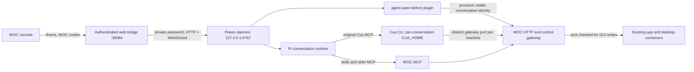

# WOC embedded client

Use `?woc=1` for the simplified WOC view. `?woc=0` restores the original Paseo UI in that tab. The fork retains the upstream chat timeline, composer, file explorer, workspace tabs, history and agent lifecycle. WOC presentation belongs in `packages/app/src/woc`; shared components have small, explicit presentation gates.

The first deployment uses one workspace, `/workspace/woc`, and one Pi provider. New conversations default to `cliproxy/deepseek-flash`; `cliproxy/glm-5.3-flash` is the other configured model. The model key lives in a private mounted file. Never copy it into source, a browser configuration response or a diagnostic transcript.

## Trust and ownership

The Agent container is separate from the control panel and application containers. It has no Docker socket and no host home mount. Its workspace, Paseo state, Pi sessions and per-conversation identities persist across restarts.

The bridge admits WOC administrators only. A conversation can access every managed machine, so accepting restricted WOC users would widen their authority. This is one shared administrator workspace, not isolated storage for multiple people. Additional user roles require an explicit ownership design before enabling them here.

The browser uses the existing WOC host cookie across ports on the same hostname. The bridge validates it through `/api/auth/me` for HTTP and WebSocket admission, and revalidates open sockets every 15 seconds. HTTP and WebSocket traffic receive the private Paseo password only inside the container. The raw daemon port is not published. Host and Origin checks reject foreign browser origins. Deploy WOC and the bridge with the same hostname; production HTTPS must cover both endpoints.

Only successful, content-hashed Expo JavaScript/CSS responses receive private immutable browser caching and streamed gzip. HTML, bootstrap responses, APIs and workspace files remain `no-store`; a script-looking filename outside that build namespace is not eligible. The cache contains shipped application code, not user data. Authentication still runs for network requests. Keep the immediately previous web build's assets during deployment so already-open clients can load their chunks; prune older releases. Publish assets before atomically replacing `index.html`.

Every conversation has a stable WOC identity and separate Cua registry. `CUA_HOME` isolates Spaces registration; `--state-dir` does **not** isolate that registry. The launch hook provisions the identity using a service credential, then injects `WOC_CLIENT_CONFIG`, `CUA_HOME` and MCP definitions. Resume uses the same identity. These are coordination identities in a trusted coding-agent container, not an OS sandbox between agents.

Restore archived conversations by Paseo agent ID (`refreshAgent`), as the upstream Unarchive action does. The legacy `resumeAgent(providerHandle)` path can create a second record, changing the lock identity. Creating through the low-level client also requires `cwd`, even when `workspaceId` is supplied.

The Cua MCP wrapper reuses WOC's reconciliation code, calls `spaces add`, and refreshes registrations while its MCP process is alive. It keeps a private ownership ledger and does not overwrite the Mac coordinator's acknowledgement diagnostics. Machine routing still depends on distinct managed gateway ports, not display names.

Read queries remain unlocked. Skills acquire and release locks for GUI writes; the gateway enforces ownership. Neither the launch hook nor the daemon performs an application workflow or obtains a GUI lock on an agent's behalf. The existing idle expiry remains the fallback if a runtime stops before releasing.

## Deployment and rollback

`woc/deploy/Dockerfile` pins the runtime tools. Build all seven Paseo packages from this checkout, pack them with `npm pack --ignore-scripts`, and apply `woc/deploy/Source.Dockerfile` to that runtime. The daemon, client and plugin SDK must come from the same source revision as the web client. The npm release labelled 0.14.0 lacks `agent.open.before`; version strings alone do not establish compatibility. Acceptance must verify the plugin is running and a real conversation receives both MCP servers. There are no custom daemon business handlers in this fork.

Deploy the compose file with immutable `WOC_AGENT_IMAGE`. Mount the built `packages/app/dist` as `web-ui`, the `woc` directory as `paseo/woc`, and the existing WOC MCP, reconciliation module and business contracts under `woc/`. Install the existing `woc-control`, `woc-wechat` and original `cua-spaces` skills under `skills/`. Keep the WOC source revision with the deployment record; it owns those contracts.

Private files under `secrets/` are `cliproxy-key`, `paseo-password` and `provision-token`. The panel receives the matching provisioning token and stores only conversation-token hashes in its data volume. The non-root runtime needs read access to secrets and write access to `state/` and `workspace/`.

To roll back, restore the previous panel image and remove its AI entry, stop only `woc-agent`, and retain its state/workspace volumes for inspection. Application and desktop containers must not be recreated. Record their IDs and start times before and after each panel deployment.

## Acceptance

Verify fresh-browser entry from WOC without pairing or another password; create a conversation with each model; stream a real reply; reload and recover history; archive, restore and delete a disposable conversation; create and view a workspace file. Confirm unauthenticated requests and foreign-origin sockets fail and logout closes an existing socket.

Use the disposable desktop for real Pi tool acceptance. Check WOC and Cua agree on machine identity, an unlocked write is denied, a lock permits a harmless operation, another conversation sees the holder and cannot write, and explicit release/idle expiry restores availability. Observe existing WeChat state without sending messages or restarting it. A server health response alone is not acceptance.

See [the first deployment acceptance record](woc-acceptance.md) for commands, results and limits.
